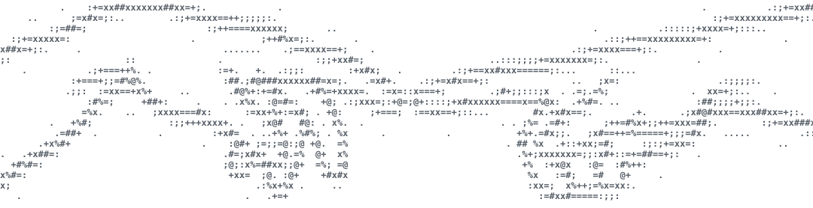

  

# Ayan Khan

**Software Engineering Intern at VSPH** · Gorakhpur, India  
BCA in Machine Learning & Data Science · Deen Dayal Upadhyaya Gorakhpur University · **Class of 2028**

I build web interfaces at VSPH. Outside work, I write C++ tools and contribute to open source. Lately I've been working on a one-command Windows installer for a CLI and figuring out how an interrupted update can leave the previous version usable.

## Selected projects

- **[diff2test](https://github.com/ThunderKhan/diff2test)** reads CMake build metadata to decide which CTest tests a change can affect. When the dependency evidence is incomplete, it widens the test run.
- **[Prometheus Compiler](https://github.com/ThunderKhan/prometheus-compiler)** takes a small experimental language from source text to low-level instructions. The lexer, recursive-descent parser, and code generator are written in C++23.
- **[IET Grid](https://github.com/ThunderKhan/iet-grid)** is a classroom scheduling project my team built for our university. Students and faculty can explore rooms on a floor map and check the timetable. [Live demo](https://iet-grid.vercel.app)
- **[Asciify](https://github.com/ThunderKhan/asciify-cpp)** converts images into text from the command line. You can set the output dimensions and choose grayscale or color.

**Tools I use** · C++, Python, TypeScript, React, FastAPI, CMake

[Portfolio](https://ayankhan.me/) · [LinkedIn](https://www.linkedin.com/in/the-ayan-khan/) · [Email](mailto:AyanKhanOffiiciall@gmail.com) · [X](https://x.com/ThunderBorneK)
